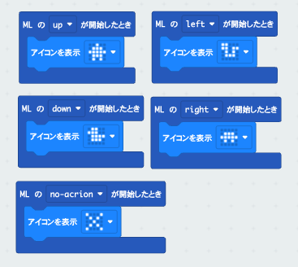
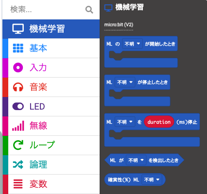
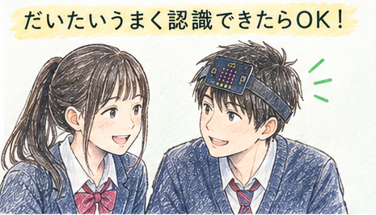

# microbit-attimuitehoi-createai 3
A guide to building an あっちむいてほい game with micro, using Create AI to recognize head movements.

> このページを開く [https://skytree-1.github.io/microbit-attimuitehoi-createai/program](https://skytree-1.github.io/microbit-attimuitehoi-createai/prgram)

## 手順

1. [micro:bit Create AI](https://createai.microbit.org/) で動きを学習させたあと、すべてのデータを記録してトレーニングして、確認ができたら右下の **(MakeCode で編集)**をクリックして、プログラム作成画面に移動します。
  
```{JavaScript}

let direction = 0

radio.setGroup(1)

// ① 自分の方向を決める
input.onGesture(Gesture.LogoUp, function () {
    direction = 0
    basic.showArrow(ArrowNames.North)
})

input.onGesture(Gesture.TiltRight, function () {
    direction = 1
    basic.showArrow(ArrowNames.East)
})

input.onGesture(Gesture.LogoDown, function () {
    direction = 2
    basic.showArrow(ArrowNames.South)
})

input.onGesture(Gesture.TiltLeft, function () {
    direction = 3
    basic.showArrow(ArrowNames.West)
})

// ② Aボタンで方向を送る
input.onButtonPressed(Button.A, function () {
    radio.sendNumber(direction)
})

// ③ 相手から受け取った方向を判定する
radio.onReceivedNumber(function (receivedNumber) {
    if (receivedNumber == 0) {
        basic.showArrow(ArrowNames.North)

        if (input.isGesture(Gesture.LogoUp)) {
            basic.showIcon(IconNames.Happy)
        } else {
            basic.showIcon(IconNames.No)
        }

    } else if (receivedNumber == 1) {
        basic.showArrow(ArrowNames.West)

        if (input.isGesture(Gesture.TiltLeft)) {
            basic.showIcon(IconNames.Happy)
        } else {
            basic.showIcon(IconNames.No)
        }

    } else if (receivedNumber == 2) {
        basic.showArrow(ArrowNames.South)

        if (input.isGesture(Gesture.LogoDown)) {
            basic.showIcon(IconNames.Happy)
        } else {
            basic.showIcon(IconNames.No)
        }

    } else {
        basic.showArrow(ArrowNames.East)

        if (input.isGesture(Gesture.TiltRight)) {
            basic.showIcon(IconNames.Happy)
        } else {
            basic.showIcon(IconNames.No)
        }
    }
})
```

2. すると、次のようなコードが埋め込まれ、メニューが追加された makecode の編集画面になります。
    
    
    
    

3. micro:bit を接続して、プログラムをダウンロードして、micro:bitをヘアバンドなどで頭にとめて、実際に頭をうごかして動作確認をしてください。ペアの相手の人に、マークをチェックしてもらってください。

   
   
5. チェックが終わったら、このコードは不要なのですてます（あると、邪魔になるので、必ず消してください）。


お疲れ様でした！
